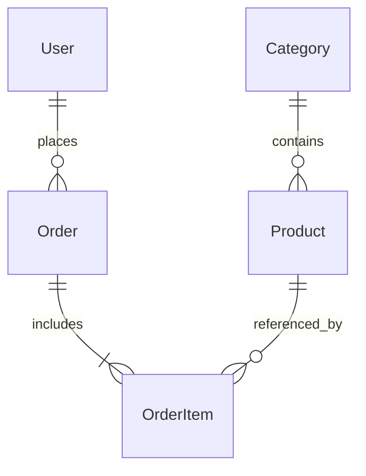

# Подготовка к предзащите — 15.10.2026

## Что сказать честно

«Я разрабатываю учебный интернет-магазин часов Tissot. В текущей версии есть каталог, регистрация, корзина, оформление заказа, личный кабинет и административная панель. Серверная часть написана на Python с Django, интерфейс — HTML и CSS. Данные демонстрационной версии хранятся в SQLite. Для MySQL предусмотрены настройки подключения и миграции; фактическое подключение ещё нужно проверить».

После реального подключения и проверки MySQL последнюю фразу можно заменить фактическим результатом. Не называйте выполненными пункты, которые только запланированы.

## Сценарий показа на 5–7 минут

1. **Тема и цель, 30 секунд.** «Цель — автоматизировать выбор часов и обработку заказов. Пользователи: покупатель и администратор».
2. **Каталог, 45 секунд.** Покажите коллекции, поиск по артикулу, сортировку и карточку товара. Объясните, что данные берутся из БД, а не повторяются в каждом HTML-файле.
3. **Регистрация, 45 секунд.** Создайте тестовый аккаунт. Объясните, что пароль хранится в виде хеша. Не показывайте реальные личные данные.
4. **Корзина, 1 минута.** Добавьте два разных товара, измените количество, удалите одну позицию. Покажите итог. Цена пересчитывается сервером по БД.
5. **Оформление, 1 минута.** Заполните вымышленные данные. Заказ появится в «Моих заказах» со статусом «Новый». Денежная операция не выполняется.
6. **Админка, 1 минута.** В другом браузере войдите администратором. Откройте заказ и поменяйте статус на «Подтверждён». Вернитесь в кабинет покупателя и обновите страницу.
7. **Устройство, 1 минута.** Покажите `models.py`, `views.py`, `services.py` и один шаблон. Кратко объясните цепочку запроса и связи таблиц.

## Как работает один запрос

```text
Браузер → URL /catalog/ → shop/urls.py → views.catalog()
        → Product.objects.filter(...) → база данных
        → templates/shop/catalog.html → готовый HTML → браузер
```

Django использует подход MVT:

- Model: описание и обработка данных (`models.py`).
- View: Python-функция, которая принимает запрос и готовит ответ (`views.py`).
- Template: HTML с переменными и циклами (`templates/`).

В терминологии Django View — обработчик, а не HTML-страница.

## Связи таблиц



- Коллекция содержит много товаров: связь «один ко многим».
- Пользователь может создать много заказов.
- Заказ содержит несколько позиций, каждая связана с товаром.
- `OrderItem` сохраняет название, артикул и цену в момент заказа. Изменение каталога не переписывает старую покупку.
- Корзина хранится в серверной сессии Django: ID товара и количество. В стандартной конфигурации сессии хранятся в таблице `django_session`, браузер получает cookie с идентификатором.

## Вопросы преподавателя и ответы

**Зачем Django, если сайт уже был на HTML?**
HTML показывает содержимое. Django выполняет серверную логику: получает товары из БД, проверяет вход, хранит заказы и формирует персональные страницы.

**Что такое ORM?**
Способ работать с таблицами через Python-классы. Например, `Product.objects.filter(is_active=True)` превращается в SQL-запрос. Значения передаются как параметры, а не склеиваются с SQL-текстом.

**Зачем миграции?**
Они описывают изменения схемы БД. `makemigrations` создаёт описание изменений, `migrate` применяет его. Это не команда импорта товаров.

**Как защищены пароли?**
Стандартная система Django хранит хеши паролей. Проверяется соответствие введённого пароля хешу; исходный пароль не хранится открытым текстом.

**Можно ли посмотреть чужой заказ, зная ссылку?**
Представление ищет заказ одновременно по номеру и текущему пользователю. Без входа будет переход на страницу входа; при входе чужим пользователем — 404.

**Почему итог нельзя подменить в браузере?**
Сервер игнорирует присланную цену и итог. Он получает цены из БД и умножает их на проверенное количество.

**Что такое транзакция?**
Группа операций, выполняемая целиком или откатываемая целиком. Создание заказа, его позиций и уменьшение остатка заключены в `transaction.atomic`.

**Как предотвращён повторный заказ?**
Форма получает UUID-токен, привязанный к сессии. В БД он уникален. При повторной отправке той же формы возвращается уже созданный заказ.

**Почему изменение корзины делается POST-запросом?**
GET предназначен для чтения. Добавление, удаление, оформление и выход меняют состояние, поэтому выполняются POST с CSRF-токеном.

**Что такое CSRF?**
Попытка заставить браузер выполнить действие на сайте от имени пользователя с посторонней страницы. Django проверяет специальный токен у изменяющих состояние запросов.

**Почему SQLite, если изучали MySQL?**
«Для текущей демонстрации выбрана файловая SQLite, поскольку нет доступа к учётной записи установленного сервера MySQL. Модели и миграции используют ORM; параметры MySQL подготовлены. Проверку на MySQL планирую выполнить после получения отдельной учебной базы». Это ограничение текущей версии, а не доказанная совместимость по результатам тестов MySQL.

**Как меняется статус?**
Администратор сохраняет поле `Order.status` через защищённую админку. Личный кабинет читает это поле из БД. Автообновление и история изменений пока не реализованы.

**Что ещё нужно до полноценного запуска?**
Подключение и тестирование MySQL, HTTPS и настройки production, защита входа от перебора, резервные копии, при необходимости платежи и доставка. Не обещайте реализованную оплату.

## План на вечер перед показом

- Запустить `START_SITE.cmd` и пройти сценарий самому без подсказки.
- Проверить пароль админки; держать покупателя и администратора в разных браузерах.
- Найти в коде четыре модели, функцию `place_order`, проверку владельца заказа и ``.
- Подготовить 2–3 скриншота как резерв на случай проблем с демонстрацией.
- Не менять в последний момент рабочую базу на MySQL без времени на повторную проверку.
- Повторить собственными словами цель проекта и цепочку «браузер — сервер — база — HTML».

## Нюанс темы

Сохраните утверждённое преподавателем название. При описании предметной области точнее говорить о магазине швейцарских часов Tissot и позиционировании выбранного ассортимента; не нужно доказывать, что каждая модель относится к высшему люксовому сегменту.

Материал — опора для подготовки: разберите и проговорите код самостоятельно. Учитывайте правила учебного заведения по использованию инструментов помощи.
